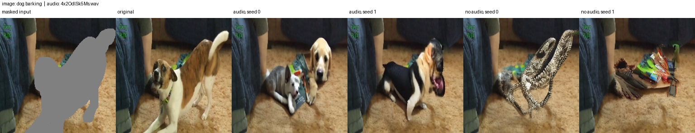
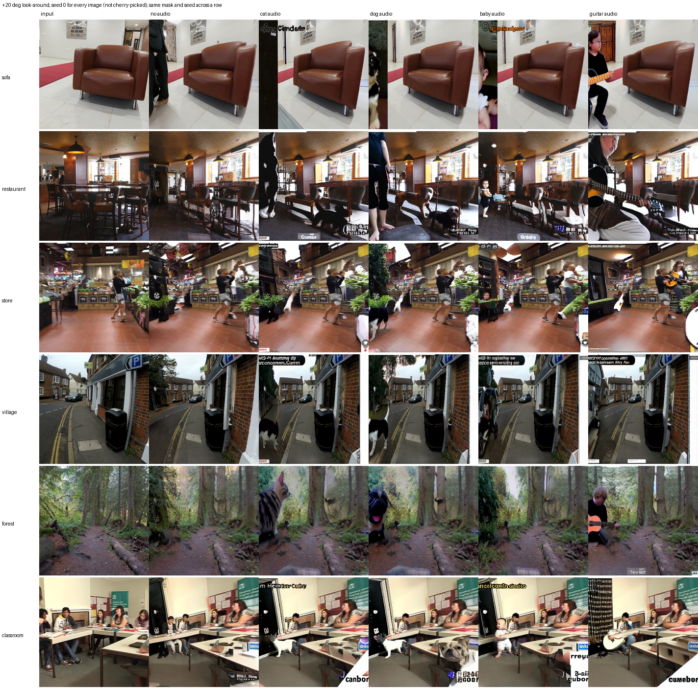

# Acoustic Visual Guided Diffusion for Missing View Image Generation

IE 643 (Deep Learning: Theory and Practice, IIT Bombay, July–Dec 2026) course project.
Team **Natural Stupidity**: Siddhesh Phadke (24b4502), Kushagra Kushwaha (24b2191).

A camera may not see part of a scene (occlusion, limited field of view) while a microphone still hears what
is there. This repository uses sound to decide what a diffusion model generates in the region the camera
did not see.

1. **Audio-conditioned inpainting (Approach 1).** Given an image, a mask and a sound clip, a frozen Stable
   Diffusion 1.5 inpainting model fills the mask with whatever is making the sound. A small trained
   adapter (5.8M parameters) turns LAION-CLAP audio features into 8 tokens that replace the words of the
   prompt "a photo of a ...", in the style of AudioToken. Only the adapter is trained, on AVSBench S4.
2. **Look around occluders (extension).** From a single photo, Depth Anything V2 depth and a
   MegaScenes-style camera move (about 15–20°) reveal regions the photo never saw; the same audio model
   fills only those regions. Nothing new is trained.

Spatial-audio (FOA) guided missing-view synthesis is our plan for the Novelty Assessment.

<p align="center"><br>
<em>S4 test clip, dog-barking audio: masked input, original, two seeds with audio (dogs), two seeds without audio.</em></p>

<p align="center"><br>
<em>Look-around on unseen photos (+20° camera move, seed 0 everywhere): input, no audio, cat, dog, baby, guitar audio.</em></p>

## Results

**Approach 1, AVSBench S4 test set** (739 clips, same seed and mask for every conditioning;
[`outputs/inpainting_eval/README.md`](outputs/inpainting_eval/README.md)):

| conditioning | CLIP top-1 on the generated region ↑ | LPIPS ↓ | FD-CLIP ↓ | PSNR (mask) |
|---|---|---|---|---|
| no audio (plain SD-1.5 inpainting) | 31.1% | 0.474 | 0.224 | 10.97 |
| wrong audio (another class) | 14.3% | 0.465 | 0.131 | 9.94 |
| **own audio (ours)** | **88.0%** | **0.423** | **0.080** | 9.97 |
| text prompt naming the class (oracle) | 86.5% | 0.447 | 0.116 | 10.35 |

With a wrong sound, the generated object is classified as the *sound's* class 48.3% of the time.
Validation loss of the training run (fixed noise and timesteps): own audio 0.0865 < no audio 0.0874 <
wrong audio 0.0876 ([`docs/audio_adapter_design.md`](docs/audio_adapter_design.md)).

**Look-around** (8 S4 test scenes × ±15° × 4 sounds × 3 seeds;
[`outputs/novel_view_eval/v1/README.md`](outputs/novel_view_eval/v1/README.md)): the sound's object is
recognised in the revealed region **60%** of the time with audio vs **6%** without, and **83%** with a
+20° orbit ([`outputs/novel_view_eval/POSE_STUDY.md`](outputs/novel_view_eval/POSE_STUDY.md)).

Report and slides: [`docs/submission/`](docs/submission/).

## Repository layout

```
models/
  clap_feature_extractor.py   frozen LAION-CLAP (HTSAT-tiny), hooks on intermediate stages, time-preserving unfold
  audio_adapter.py            the trained AudioAdapter: CLAP features -> 8 tokens of width 768
  audio_token_conditioner.py  splices the tokens into the CLIP prompt -> [B, 77, 768] for the U-Net
  depth_anything_v2.py        Depth Anything V2 wrapper, disparity -> MegaScenes-normalized depth
  megascenes_warp.py          camera poses, depth mesh, rendering from a new pose, hole rules
  novel_view_pipeline.py      NovelViewAudioInpainter: depth -> warp -> audio inpainting
dataloaders/avs_s4.py         S4 frames, masks, cached CLAP features, training mask mixture
scripts/
  download_weights.py         fetch the frozen pre-trained weights into models/
  cache_clap_features.py      run CLAP once over all S4 clips
  train_audio_adapter.py      training, validation (own / wrong / no audio), sample grids, checkpoints
  sample_audio_inpaint.py     Approach-1 inference on any image + mask + WAV
  novel_view_audio_inpaint.py look-around inference on any photo + WAV
  eval_inpainting.py          S4 test-set evaluation of Approach 1 (PSNR, SSIM, LPIPS, FD-CLIP, CLIP top-1)
  eval_novel_view.py          look-around evaluation grid, scored with CLIP on the generated pixels
  compare_pose_study.py       compares look-around runs that differ only in the camera pose
  test_audio_adapter.py       prints tensor shapes through the pipeline
tests/                        unit tests: adapter pipeline (8) and warp geometry (10)
runs/s4_v1/                   the trained model: last.pt, args.json, log.jsonl, sample grids
runs/smoke*/                  short pipeline tests run before training (logs and samples)
outputs/                      evaluation reports, contact sheets and demo images
docs/                         design notes, dataset survey, report and slides
examples/ecohubsofa.jpeg      a phone photo used in the look-around samples
third_party/                  git submodules: Depth-Anything-V2 and MegaScenes nvs
*.ipynb                       early exploration notebooks (CLAP embeddings, text-prompted SD inpainting)
```

## Setup

Tested on Linux with Python 3.13.5, PyTorch 2.6.0 (CUDA 12.4) and an NVIDIA RTX A5000 (24 GB).
Training peaked at 6 GB of GPU memory.

```bash
git clone --recursive https://github.com/siddheshsp0/ie-643-project.git && cd ie-643-project
# if you cloned without --recursive:
git submodule update --init

python3.13 -m venv .venv && source .venv/bin/activate
pip install torch==2.6.0 torchvision==0.21.0 --index-url https://download.pytorch.org/whl/cu124
pip install -r requirements.txt
pip install --no-deps pyrender==0.1.45      # its PyOpenGL pin (3.1.0) breaks EGL on Python 3.13

python scripts/download_weights.py          # about 5 GB: SD-1.5 inpainting, CLIP ViT-L/14, Depth Anything V2, LAION-CLAP
```

The trained adapter is included: `runs/s4_v1/last.pt` (step 20,000). Datasets are only needed for training
and evaluation; see [`data/README.md`](data/README.md). The look-around renderer uses EGL (headless GPU
OpenGL); MegaScenes' code falls back to OSMesa when EGL is unavailable.

## Usage

All commands run from the repository root. Use `CUDA_VISIBLE_DEVICES` to pick a GPU.

**Audio-conditioned inpainting** on your own inputs (mask: white = region to fill; omit it to regenerate the
whole image). Writes the results with audio, the same seeds without audio, and an overview sheet:

```bash
python scripts/sample_audio_inpaint.py --ckpt runs/s4_v1/last.pt \
    --image photo.jpg --mask mask.png --wav sound.wav --no-audio-baseline --out outputs/my_test

# an S4 test clip by id (uses its frame, mask and audio); add --wav other.wav to swap the sound
python scripts/sample_audio_inpaint.py --ckpt runs/s4_v1/last.pt \
    --s4-split test --s4-name 4x2OdlSk5Ms --no-audio-baseline --out outputs/demo_dog
```

**Look around occluders** (any photo and WAV; `--yaw-deg` sets the camera move, `--tz` overrides the forward
motion; the default checkpoint is `runs/s4_v1/last.pt`):

```bash
python scripts/novel_view_audio_inpaint.py --image examples/ecohubsofa.jpeg --wav sound.wav \
    --yaw-deg 20 --no-audio-baseline --out outputs/novel_view/sofa
python scripts/novel_view_audio_inpaint.py --image examples/ecohubsofa.jpeg --wav sound.wav \
    --yaw-deg -15 --tz 0.2588 --no-audio-baseline --out outputs/novel_view/sofa_left   # -15°, moving back
```

**Training** (needs S4 in `data/`):

```bash
python scripts/cache_clap_features.py                                   # once, about 2 min
python scripts/train_audio_adapter.py --run-name s4_v1                  # 20k steps, about 6 h on one A5000
# smoke test on 16 class-balanced clips
python scripts/train_audio_adapter.py --run-name smoke --max-train-samples 16 --max-steps 300 \
    --warmup-steps 20 --num-val 16 --val-every 100 --sample-every 300 --save-every 300
```

Hyper-parameters (AdamW, lr 8e-5, cosine with 500 warm-up steps, batch 4 × 2 accumulation, mask-weighted
noise-prediction loss with α = 2, ℓ1 token weight 1e-3, condition dropout 0.1) are the script defaults and
are recorded in `runs/s4_v1/args.json`.

**Evaluation**:

```bash
# Approach 1 on the S4 test set (about 35 min on two GPUs), then scoring
CUDA_VISIBLE_DEVICES=0 python scripts/eval_inpainting.py generate --shard 0 --num-shards 2 &
CUDA_VISIBLE_DEVICES=1 python scripts/eval_inpainting.py generate --shard 1 --num-shards 2; wait
python scripts/eval_inpainting.py report                 # -> outputs/inpainting_eval/README.md

# look-around grid and pose variants
CUDA_VISIBLE_DEVICES=0 python scripts/eval_novel_view.py generate --shard 0 --num-shards 2 &
CUDA_VISIBLE_DEVICES=1 python scripts/eval_novel_view.py generate --shard 1 --num-shards 2; wait
python scripts/eval_novel_view.py report                 # -> outputs/novel_view_eval/v1/README.md
python scripts/compare_pose_study.py v1 v2_noforward v2_rotonly v2_focal200 v2_yaw20
```

**Tests**:

```bash
python -m unittest tests.test_audio_adapter tests.test_megascenes_warp -v
```

## Documentation

- [`docs/audio_adapter_design.md`](docs/audio_adapter_design.md): Approach 1 in detail (CLAP stages, adapter,
  prompt splice, loss, training, validation results).
- [`docs/novel_view_pipeline.md`](docs/novel_view_pipeline.md): the look-around pipeline, what comes from
  MegaScenes and where we deviate (the stretch hole rule).
- [`docs/dataset_survey.md`](docs/dataset_survey.md): the datasets we considered.
- [`docs/submission/`](docs/submission/): project report and presentation slides.

## Credits and licences

- Stable Diffusion 1.5 inpainting (Runway, CreativeML OpenRAIL-M licence), LAION-CLAP
  (https://github.com/LAION-AI/CLAP), CLIP ViT-L/14 (OpenAI), Hugging Face diffusers and transformers.
- `third_party/Depth-Anything-V2` (https://github.com/DepthAnything/Depth-Anything-V2, code Apache-2.0;
  the ViT-L weights are CC-BY-NC-4.0, non-commercial).
- `third_party/megascenes_nvs` (https://github.com/MegaScenes/nvs): only its pose, mesh and render code
  is used; its diffusion checkpoints are not.
- AVSBench (https://opennlplab.github.io/AVSBench/, CC-BY-NC-4.0).
- AudioToken (Yariv et al., Interspeech 2023) for the adapter design.
