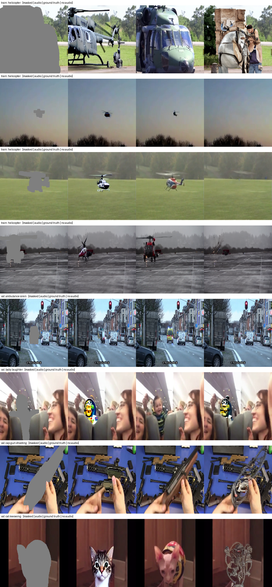
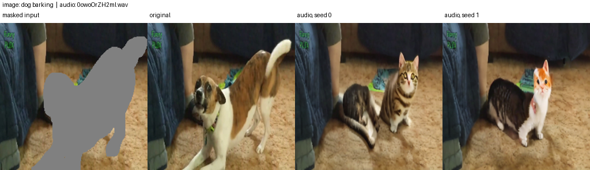

# Audio-Conditioned Inpainting: CLAP → Stable Diffusion Adapter

**One line:** a small trainable adapter (5.8M parameters) turns a sound clip into 8 "audio words" that fill in the prompt *"a photo of a \_\_\_"*, so a frozen Stable Diffusion 1.5 Inpainting model paints the sounding object into a masked region of an image.

Approach: **AudioToken** (Yariv et al., 2023), adapted to a LAION-CLAP audio encoder, multi-token output, and inpainting.

---

## 1. Big picture

```
 WAV (5–10 s)                         image + mask (white = repaint)
   │                                          │
   ▼                                          │
 ┌────────────────────────────┐               │
 │ CLAP audio encoder         │  FROZEN       │
 │ (HTSAT-tiny Swin)          │               │
 └────────────┬───────────────┘               │
   3 intermediate stages + global embedding   │
              ▼                               │
 ┌────────────────────────────┐               │
 │ AudioAdapter               │  TRAINED      │
 │ 5.8M params                │  (only part)  │
 └────────────┬───────────────┘               │
   8 audio tokens [B,8,768]                   │
              ▼                               │
 ┌────────────────────────────┐               │
 │ CLIP text encoder          │  FROZEN       │
 │ "a photo of a * * * * * * * *"             │
 └────────────┬───────────────┘               │
   encoder_hidden_states [B,77,768]           │
              ▼                               ▼
 ┌──────────────────────────────────────────────────────┐
 │ SD-1.5 Inpainting U-Net (cross-attention)  FROZEN    │
 │ + VAE                                                │
 └──────────────────────────────────────────────────────┘
              ▼
       inpainted image (512×512)
```

**Key idea:** we don't retrain the image generator. We teach a small module to translate audio into the "word space" Stable Diffusion already understands.

---

## 2. Audio encoder: LAION-CLAP (frozen)

- **Checkpoint:** `630k-audioset-best.pt` (HTSAT-tiny audio branch, non-fusion).
- **Why CLAP:** it was trained to align audio with text, so its features encode *what the sound is*, which is useful for picking the right object.
- **Input preprocessing:** 48 kHz mono, int16 round-trip. Clips shorter than 10 s are repeat-padded; longer ones are cropped deterministically from the start.

### Inside HTSAT (measured on a real WAV)

| Stage | Module | Token grid | Channels | Unfolded output used |
|---|---|---|---|---|
| Patch embed | `patch_embed` | 64×64 | 96 | – |
| Stage 1 | `layers.0` | 32×32 | 192 | (not used) T=128 |
| **Stage 2** | `layers.1` | 16×16 | 384 | **[B, 64, 384]** |
| **Stage 3** | `layers.2` | 8×8 | 768 | **[B, 32, 768]** |
| Stage 4 | `layers.3` | 8×8 | 768 | – |
| **Final norm** | `norm` | 8×8 | 768 | **[B, 32, 768]** |
| **Global** | `audio_projection` + L2 norm | – | 512 | **[B, 512]** |

- **4-stage Swin, not a 12-layer ViT:** so the paper's "layers 4/8/12" don't apply. We take mid-level, high-level and final stages, plus the clip-level embedding.
- **Unfolding:** HTSAT folds 1024 spectrogram frames into a 256×256 "image" (4 time chunks stacked vertically). We undo this exactly and average over frequency only, so time resolution is kept: ~156 ms per step for stage 2 and ~312 ms for stages 3 and 4.
- **Verified:** averaging our unfolded `norm` output over time reproduces CLAP's own internal embedding (unit test T1).
- **Extraction:** forward hooks capture the stages in a single CLAP pass. Features for all 4,932 S4 clips are cached once (fp16, 699 MB).

---

## 3. The AudioAdapter (trainable)

```
 layers.1  [B,64,384] ─Linear→768─┐
 layers.2  [B,32,768] ─Linear→768─┤  + learned source embedding (one per source)
 norm      [B,32,768] ─Linear→768─┤
 global    [B,512]    ─Linear→768─┘  → [B,1,768]
                                  │
                     concat along time: [B,129,768]   (64+32+32+1)
                                  │
             MLP: Linear(768→1024) → GELU → Linear(1024→768)   (per token)
                                  │
       Multi-token attention pooling: 8 learned queries, 8 heads
       Q = queries [1,8,768] (shared across batch), K = V = 129 tokens
                                  │
                     audio tokens [B,8,768]
```

| Component | Role | Params |
|---|---|---|
| 4 × FeatureProjection | Bring each source (384/768/768/512-d) to CLIP word width 768 | 1,870,848 |
| Source embeddings (4×768) | Tell pooling which CLAP layer a token came from (pooling has no positional encoding) | 3,072 |
| MLP 768→1024→768, GELU | Paper's W₂·GELU(W₁·a): map audio features toward CLIP word space | 1,574,656 |
| Attention pooling (8 queries + MHA) | Summarize 129 tokens into 8 output tokens | 2,368,512 |
| **Total** | | **5,817,088** |

Design notes:
- Concatenating along **time** (not features) keeps every stage at its native resolution, with no resampling.
- **Configurable:** number of tokens N, heads, hidden size, CLAP layers, and source embeddings on/off (for ablation).
- Shape assertions run at every step. Checkpoints store `{adapter_config, state_dict}` so the adapter can be rebuilt exactly.

---

## 4. Injecting audio into Stable Diffusion (AudioToken style)

**Prompt ids (77 positions):**

```
<start> a photo of a  *  *  *  *  *  *  *  *  <end> <pad> … <pad>
  0     1  2    3  4  5 ─────────────────── 12  13    14 … 76
```

- **Splice:** a temporary forward hook on CLIP's token-embedding layer replaces positions 5–12 with the 8 audio tokens. CLIP then runs normally (position embeddings, causal mask, 12 layers, final LayerNorm), giving **[B,77,768]**.
- **Why a hook:** transformers 5.x `CLIPTextModel` accepts only token ids, not embeddings. The splice is verified exact (unit test T6).
- **Gradient path:** CLIP is frozen but not wrapped in `no_grad`, so gradients flow *through* it back to the adapter.
- **Causal-mask effect:** positions 0–4 ("a photo of a") never see the audio. Everything from position 5 onward does, including the `<end>`/padding positions.
- **U-Net input:** 9 channels = noisy latents (4) + mask (1) + masked-image latents (4). Image features attend to the 77×768 conditioning through cross-attention.

---

## 5. Comparison with the AudioToken paper

| | AudioToken | This work |
|---|---|---|
| Audio encoder | BEATs (12 layers) | LAION-CLAP HTSAT-tiny (4 stages) |
| Layers used | 4, 8, 12 | Stage 2, stage 3, final norm, + global embedding |
| Combining layers | Concatenate along features | Per-source projection + source embedding, concatenate along time |
| MLP | Linear–GELU–Linear | Same (768→1024→768) |
| Pooling | Attentive pooling → 1 token | 8 learned queries → **8 tokens** |
| Injection | Token after "A photo of a" → CLIP → U-Net | Same, 8 tokens |
| Generator | SD (text-to-image) | **SD-1.5 Inpainting** |
| Loss | L_LDM + λ·‖e‖₁ (+ optional class loss) | Same; class loss implemented but off in this run |
| Trainable params | ~8.85M | 5.82M |
| Data | VGGSound (~200k clips) | AVSBench S4 (3,452 training clips) |

---

## 6. Training setup

### Data: AVSBench Single-Source (S4)

| | Train | Val | Test |
|---|---|---|---|
| Clips (5 s, 23 classes) | 3,452 | 740 | 740 |
| Frames per clip (224×224, 1/s) | 5 | 5 | 5 |
| Sounding-object masks | frame 1 only | all 5 | all 5 |

- Frames are resized to 512×512. Object masks are dilated by 8 px. Random horizontal flips are applied.
- The whole 5 s clip's audio conditions each frame.

### Mask mix (each training sample)

| Probability | Mask | Teaches |
|---|---|---|
| 60% | Ground-truth sounding-object mask (frame 1) | Draw the sounding object in context |
| 20% | Random box, 10–50% of the image | General inpainting from audio |
| 20% | Full mask | Generate the whole scene from audio |

### One training step

```
z0        = VAE(image)                    z_masked = VAE(image · (mask < 0.5))
m64       = mask resized to 64×64
z_t       = add_noise(z0, ε, t),  t ~ U{0…999}
cond      = CLIP("a photo of a" + Adapter(CLAP features))
            → replaced by the empty-prompt encoding with p = 0.1 (for CFG)
ε̂         = UNet([z_t, m64, z_masked], t, cond)

loss      = Σ w·(ε̂ − ε)² / Σ w     with  w = 1 + 2·m64   (focus on the masked region)
          + 0.001 · mean|tokens|    (AudioToken L1 term)
          + 0     · L_class         (optional, off in this run)
```

### Hyperparameters (run `s4_v1`)

| Setting | Value |
|---|---|
| Optimizer | AdamW, lr 8e-5 (paper), weight decay 0.01 |
| Schedule | 500 warmup steps, cosine decay |
| Batch | 4 × 2 gradient accumulation = **8** (paper) |
| Steps | 20,000 optimizer steps (~46 epochs) |
| Gradient clipping | 1.0 |
| Condition dropout | 0.1 |
| Mask loss weight α | 2.0 |
| L1 weight | 1e-3 |
| Class-loss weight | 0 (off) |
| Seed | 0 |

### Precision and compute

- **Frozen models:** U-Net in fp32 weights with bf16 autocast and gradient checkpointing; VAE in fp16 (`no_grad`); CLIP text encoder in fp32.
- **Hardware:** 1× NVIDIA RTX A5000 (24 GB). Peak memory **6.0 GB**. Throughput **~0.94 optimizer steps/s**.
- **Training time:** about **6 h** of training steps, plus periodic validation and sampling.

### Validation protocol

- **Val subset:** 64 clips covering all 23 classes, frame 1 with its object mask.
- **Fixed noise and timesteps** for every evaluation, so checkpoints are comparable.
- **Three conditions** scored on mask-weighted MSE:
  - **audio:** the clip's own audio
  - **shuffled:** another clip's audio
  - **empty:** no audio
- **Success criterion:** audio < empty < shuffled.
- **Qualitative check:** a sample grid every 2k steps (DDIM, 30 steps, guidance 7.5) with columns masked | audio | ground truth | no audio, same seed.

---

## 7. Results

### Validation MSE (lower is better)

| Step | Audio | Shuffled | Empty | Gap (shuffled − audio) |
|---|---|---|---|---|
| 0 (untrained) | 0.0875 | 0.0876 | 0.0874 | +0.0001 |
| 2,000 | 0.0869 | 0.0875 | 0.0874 | +0.0006 |
| 10,000 | 0.0867 | 0.0875 | 0.0874 | +0.0008 |
| **20,000** | **0.0865** | 0.0876 | 0.0874 | **+0.0010** |

- **Matched audio beats both no audio and wrong audio.** The gap widened steadily through the whole run, with no overfitting, so the best checkpoint is the last one.
- **Small absolute gaps are expected:** most of the diffusion loss is irreducible noise that no conditioning can remove.
- **Token norm:** started at 0.70 (CLIP word embeddings ≈ 0.39), peaked near 1.5 mid-training, and settled at ≈ 0.98 by the end.

### Qualitative results

**Final validation grid:** `runs/s4_v1/samples/step_020000.png`



| Clip | With audio | Same seed, no audio |
|---|---|---|
| Train, helicopter | Helicopter | Empty sky or an unrelated object |
| Val, cat meowing | Kitten | Abstract ornament |
| Val, cap gun shooting | Gun in hand | Metal filigree |
| Val, baby laughter | Cartoon toy (miss) | Toy |
| Val, ambulance siren | Nothing visible in a tiny mask (miss) | – |

**Unseen test clip, and audio swap:** clip `4x2OdlSk5Ms`, dog barking.




- **Dog audio:** dogs, for both seeds.
- **No audio:** a snake-like coil and clutter.
- **Cat audio, same frame, mask and seeds:** cats. **The sound decides what gets drawn.**

---

## 8. Engineering notes and lessons

- **Smoke tests before the full run:** short runs on 16 clips verified the full loop (training, validation, sampling, checkpointing) cheaply.
- **Bug caught by a smoke test:** the S4 CSV is sorted by class, so "first N clips" were all helicopters and the shuffled-audio control was meaningless. Subsets are now round-robin across classes.
- **Frozen features are cached:** CLAP runs once per clip (about 2 min for the full dataset), not every step.
- **Unit tests** (`tests/test_audio_adapter.py`, 8 tests) cover:
  - shapes and finiteness
  - the HTSAT unfolding
  - gradient flow (adapter only)
  - batching
  - save/load
  - the CLIP splice
  - U-Net compatibility

---

## 9. Code map

| File | Purpose |
|---|---|
| `models/clap_feature_extractor.py` | Frozen CLAP; stage hooks; unfolding; global embedding |
| `models/audio_adapter.py` | `FeatureProjection`, `MultiTokenAttentionPooling`, `AudioAdapter` |
| `models/audio_token_conditioner.py` | Splices audio tokens into CLIP after "a photo of a" |
| `dataloaders/avs_s4.py` | S4 dataset, mask mixing, class-balanced subsets |
| `scripts/cache_clap_features.py` | Precomputes CLAP features for all clips |
| `scripts/train_audio_adapter.py` | Training, validation, sample grids, checkpoints |
| `scripts/sample_audio_inpaint.py` | Inference with a trained checkpoint |
| `scripts/test_audio_adapter.py` | Diagnostic shape printout |
| `tests/test_audio_adapter.py` | Unit tests |

```bash
PY=python
$PY scripts/cache_clap_features.py                                         # once
CUDA_VISIBLE_DEVICES=1 $PY scripts/train_audio_adapter.py --run-name s4_v1 --max-steps 20000
CUDA_VISIBLE_DEVICES=1 $PY scripts/sample_audio_inpaint.py --ckpt runs/s4_v1/last.pt \
    --s4-split test --s4-name 4x2OdlSk5Ms --no-audio-baseline --out outputs/demo_dog
$PY -m unittest tests.test_audio_adapter -v
```

---

## 10. Limitations and next steps

- **Low-resolution frames:** 224×224 frames are upscaled to 512, so outputs inherit blur. Next: re-extract 720p frames from `raw_videos/` (after checking mask alignment).
- **Weak classes:** baby laughter and very small masks (e.g. a distant ambulance) still fail. Small masks give the audio little area to act on.
- **Repeat-padding:** 5 s clips are repeat-padded to CLAP's 10 s window, so about half the time tokens are duplicates.
- **No time position inside a source:** the pooling knows which layer a token came from, but not when in the clip it occurred.
- **Evaluation:** only the validation loss and visual grids so far. Next: test-set CLIP score against the class label, zero-shot class accuracy, and FID, plus the text-prompt upper bound and no-audio baseline.
- **Ablations:**
  - source embeddings off
  - N = 1 vs 8 tokens
  - class loss on
  - different CLAP layers

---

## Reference

G. Yariv, I. Gat, L. Wolf, Y. Adi, I. Schwartz. *AudioToken: Adaptation of Text-Conditioned Diffusion Models for Audio-to-Image Generation.* Interspeech 2023. (`resources/`)
