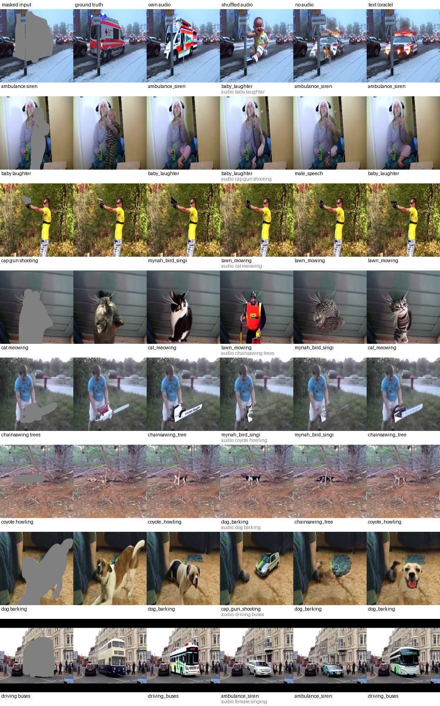

# Audio-conditioned inpainting: S4 test-set evaluation

Generated by `scripts/eval_inpainting.py report`.

- **Data:** 739 AVSBench S4 test clips (all 23 classes), frame 1, ground-truth sounding-object mask dilated by 8 px, 512 × 512.
- **Sampling:** SD-1.5 inpainting, DDIM 30 steps, guidance 7.5, seed = clip index (identical across conditionings), generated pixels pasted back into the original frame.
- **Checkpoint:** `runs/s4_v1/last.pt` (20k steps). Audio features: cached CLAP features of the test split.
- PSNR on masked pixels; SSIM on the mask's bounding box; LPIPS (AlexNet) on the bounding box at 256 px; FD-CLIP = Fréchet distance of CLIP ViT-L/14 features of generated vs real region crops; CLIP top-1 = zero-shot accuracy over the 23 S4 classes on the generated region (outside the mask gray).
- CLIP top-1 on the **real** region (classifier ceiling): 93.1%.

| conditioning | PSNR ↑ | SSIM ↑ | LPIPS ↓ | FD-CLIP ↓ | CLIP top-1 ↑ | P(class) ↑ |
|---|---|---|---|---|---|---|
| own audio (ours) | 9.97 ± 0.17 | 0.519 | 0.423 | 0.080 | 88.0% ± 2.3 | 0.839 |
| wrong audio (shuffled) | 9.94 ± 0.19 | 0.525 | 0.465 | 0.131 | 14.3% ± 2.5 | 0.130 |
| no audio (SD-1.5 inpainting) | 10.97 ± 0.19 | 0.516 | 0.474 | 0.224 | 31.1% ± 3.3 | 0.254 |
| text prompt with class label (oracle) | 10.35 ± 0.18 | 0.525 | 0.447 | 0.116 | 86.5% ± 2.5 | 0.836 |

± is a 95% normal interval over clips.

- **Wrong audio follows the sound:** with another class's audio, CLIP assigns the generated region to the *audio's* class 48.3% of the time and to the image's class 14.3% of the time.
- **Paired (same clip, seed, mask):** own audio gives a higher CLIP probability of the true class than no audio for 92.0% of clips, and a lower LPIPS for 73.7%.

## Per class (CLIP top-1)

| class | n | own audio | wrong audio | no audio | text (oracle) |
|---|---|---|---|---|---|
| ambulance siren | 29 | 83% | 34% | 38% | 66% |
| baby laughter | 14 | 93% | 7% | 14% | 93% |
| cap gun shooting | 18 | 83% | 17% | 33% | 94% |
| cat meowing | 27 | 100% | 0% | 22% | 100% |
| chainsawing trees | 37 | 68% | 24% | 46% | 76% |
| coyote howling | 9 | 67% | 11% | 22% | 89% |
| dog barking | 39 | 85% | 8% | 21% | 95% |
| driving buses | 22 | 77% | 18% | 18% | 91% |
| female singing | 45 | 84% | 2% | 22% | 84% |
| helicopter | 47 | 91% | 15% | 32% | 89% |
| horse clip-clop | 28 | 93% | 14% | 46% | 89% |
| lawn mowing | 12 | 92% | 0% | 67% | 100% |
| lions roaring | 37 | 95% | 11% | 8% | 89% |
| male speech | 34 | 88% | 3% | 32% | 65% |
| mynah bird singing | 30 | 100% | 37% | 77% | 90% |
| playing acoustic guitar | 45 | 100% | 27% | 58% | 100% |
| playing glockenspiel | 33 | 97% | 39% | 27% | 70% |
| playing piano | 45 | 91% | 16% | 9% | 87% |
| playing tabla | 41 | 98% | 0% | 20% | 88% |
| playing ukulele | 30 | 47% | 17% | 57% | 87% |
| playing violin | 44 | 93% | 7% | 11% | 80% |
| race car | 31 | 77% | 0% | 23% | 81% |
| typing on computer keyboard | 42 | 95% | 17% | 36% | 100% |

## Qualitative (first 8 clips in class-balanced order, not cherry-picked)

Caption under each generated image: CLIP top-1 class on the generated region.

