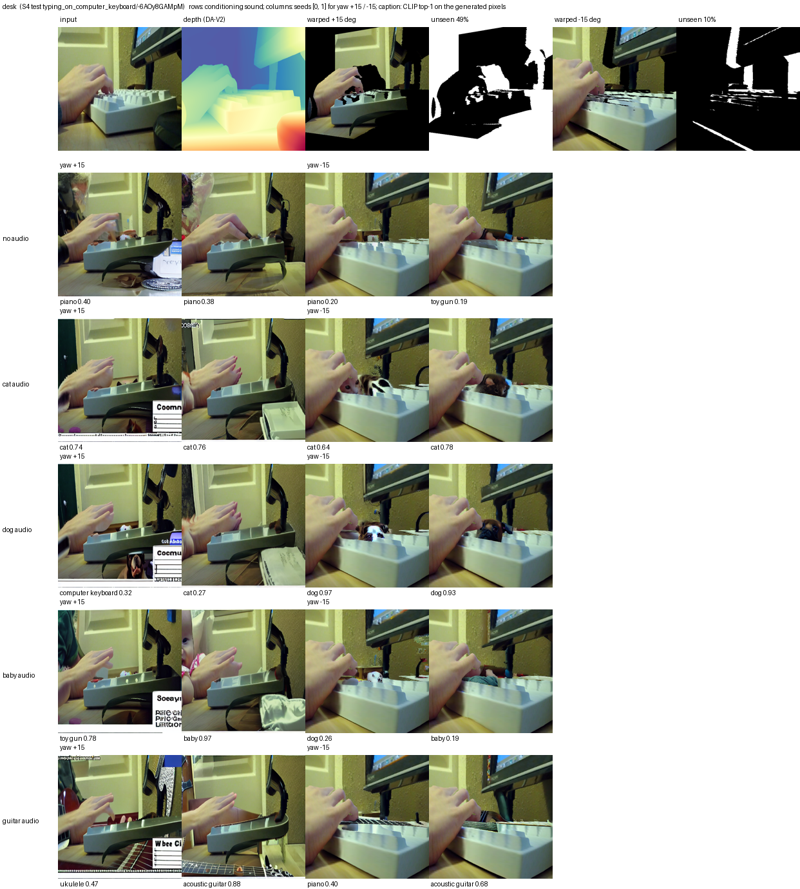
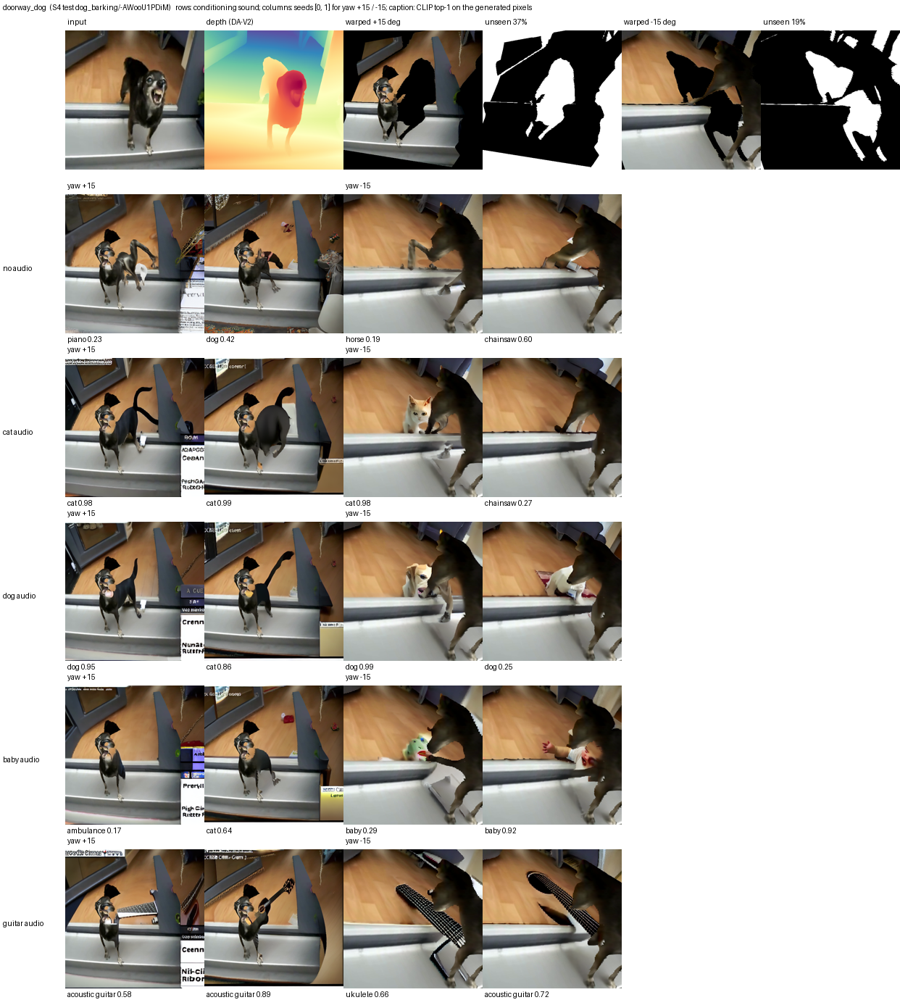
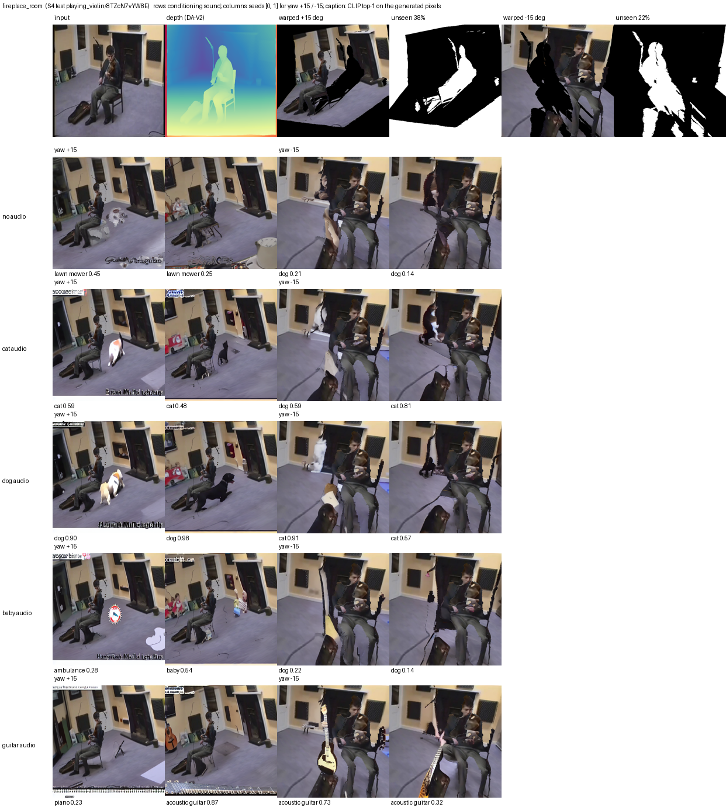
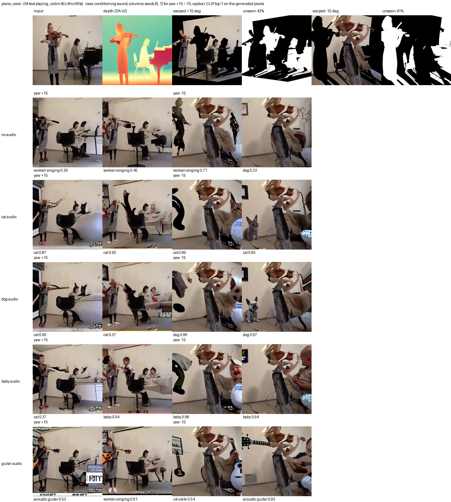
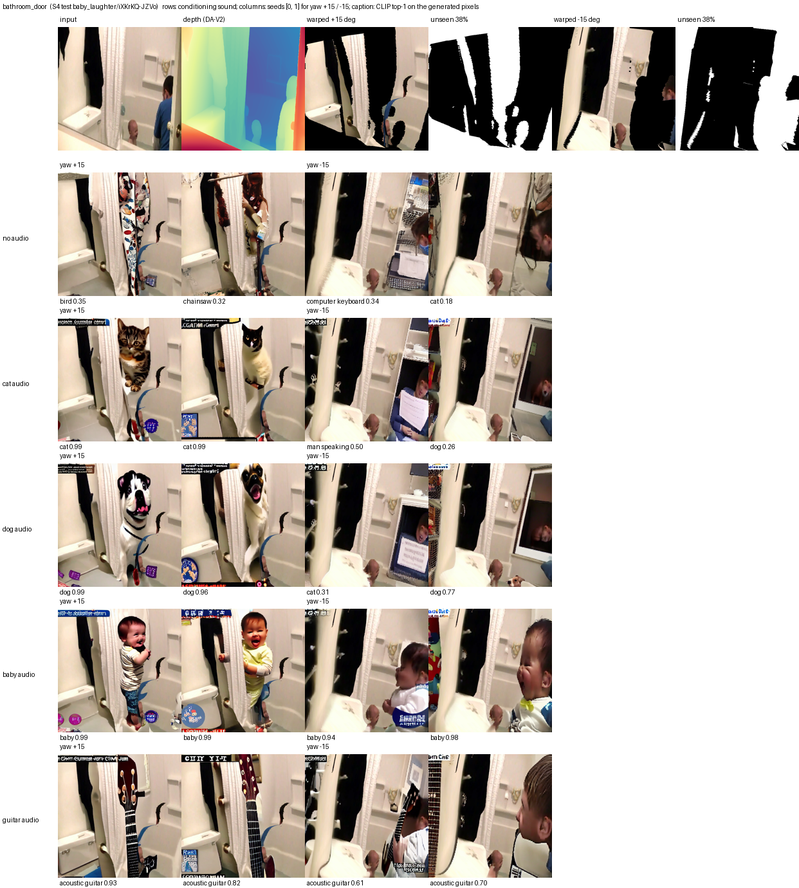
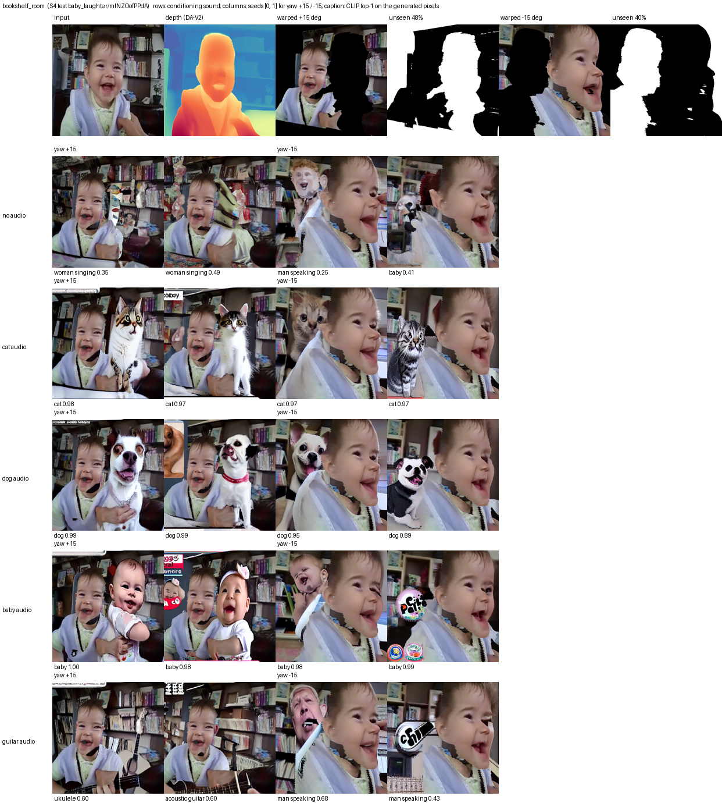
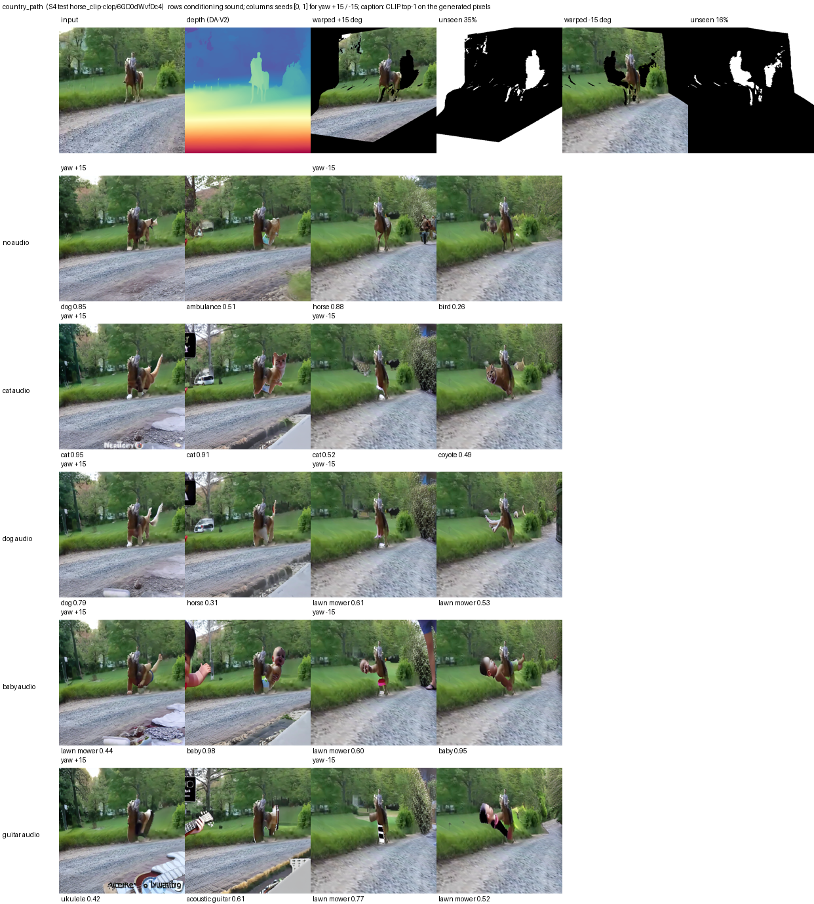
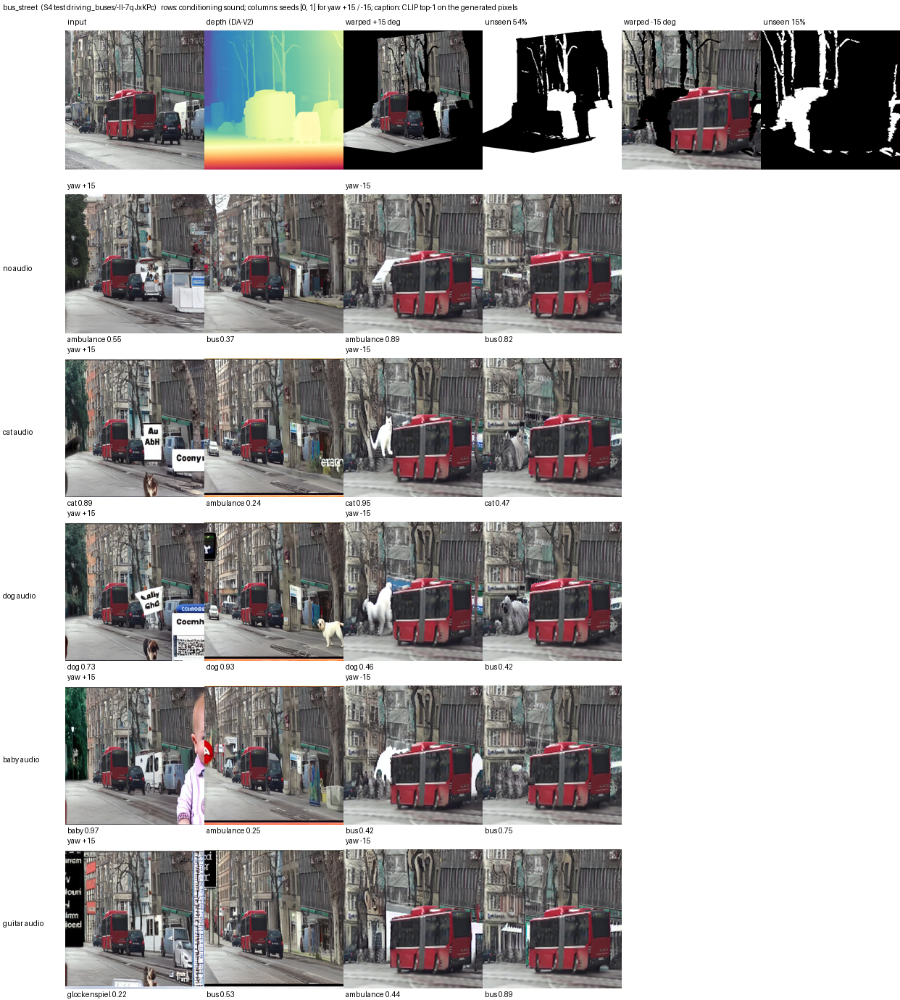
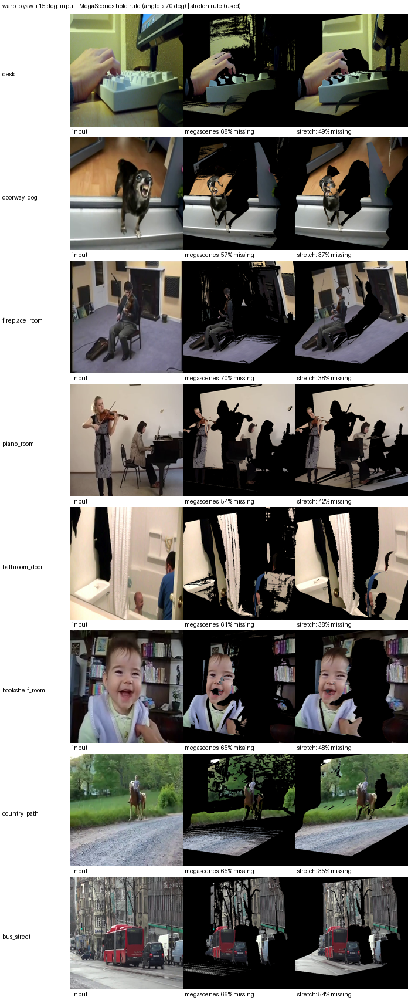

# Look-around evaluation (depth → MegaScenes warp → audio-conditioned inpainting)

Generated by `scripts/eval_novel_view.py report`.

- **Grid:** 8 scenes × 2 poses (yaw +15°, -15°, MegaScenes orbit; focal 200 px at 256 px, ≈65° FoV) × 5 conditions (no audio + cat, dog, baby, guitar) × 2 seeds = **160 images**, 50 DDIM steps, guidance 7.5, mask dilation 8 px.
- Scenes and sounds are AVSBench S4 **test** clips (frames are 224 px, upscaled to 512).
- Audio and no-audio images use the same seeds and masks, so they differ only in the conditioning.
- **Score:** CLIP ViT-L/14 zero-shot over the 23 S4 classes (`a photo of {object}.`), shown **only the generated pixels** (mask bounding box, everything else gray). It measures whether the requested object appears in the revealed region; it does not judge realism.

## Does the sound decide what appears?

| sound | CLIP class | top-1 with audio | top-1 without audio | P(class) with / without | audio > no-audio (paired) |
|---|---|---|---|---|---|
| cat | a cat | **81%** | 3% | 0.71 / 0.05 | 97% |
| dog | a dog | **62%** | 16% | 0.60 / 0.10 | 88% |
| baby | a baby | **59%** | 3% | 0.54 / 0.04 | 91% |
| guitar | an acoustic guitar | **50%** | 0% | 0.43 / 0.01 | 94% |
| **all** | | **63%** | 5% | | 92% |

Each audio row has 32 images; "without audio" scores the same no-audio images against that row's class.

**Mean CLIP probability of each class (columns) per conditioning (rows):** the diagonal should dominate.

| conditioning | a cat | a dog | a baby | an acoustic guitar |
|---|---|---|---|---|
| no audio | 0.05 | 0.10 | 0.04 | 0.01 |
| cat | **0.71** | 0.09 | 0.01 | 0.00 |
| dog | 0.16 | **0.60** | 0.02 | 0.00 |
| baby | 0.06 | 0.05 | **0.54** | 0.01 |
| guitar | 0.01 | 0.01 | 0.00 | **0.43** |

**By pose** (top-1 hit rate, audio vs no audio):

| sound | yaw +15° | yaw -15° |
|---|---|---|
| cat | 94% vs 0% | 69% vs 6% |
| dog | 62% vs 12% | 62% vs 19% |
| baby | 56% vs 0% | 62% vs 6% |
| guitar | 56% vs 0% | 44% vs 0% |

## Per scene

| scene | unseen pixels +15° / -15° | inpainted (dilated) | top-1 hit, audio | top-1 hit, no audio | sheet |
|---|---|---|---|---|---|
| desk | 49% / 10% | 62% / 23% | 62% | 0% | [png](sheets/desk.png) |
| doorway_dog | 37% / 19% | 50% / 32% | 69% | 6% | [png](sheets/doorway_dog.png) |
| fireplace_room | 38% / 22% | 50% / 34% | 56% | 12% | [png](sheets/fireplace_room.png) |
| piano_room | 42% / 41% | 61% / 57% | 69% | 6% | [png](sheets/piano_room.png) |
| bathroom_door | 38% / 38% | 51% / 49% | 81% | 6% | [png](sheets/bathroom_door.png) |
| bookshelf_room | 48% / 40% | 60% / 48% | 81% | 6% | [png](sheets/bookshelf_room.png) |
| country_path | 35% / 16% | 46% / 24% | 44% | 6% | [png](sheets/country_path.png) |
| bus_street | 54% / 15% | 71% / 33% | 44% | 0% | [png](sheets/bus_street.png) |

## Contact sheets

Header: input, depth, and for each pose the warped view (black = never seen) and the unseen-pixel mask. Rows: conditioning sound. Columns: seeds per pose. Caption: CLIP top-1 class and probability on the generated pixels.

### desk



### doorway_dog



### fireplace_room



### piano_room



### bathroom_door



### bookshelf_room



### country_path



### bus_street



## Hole rule: MegaScenes angle rule vs stretch rule



## Files

```
scenes/<scene>/input.png, depth.png, depth.npy, scene.json (pose, unseen/inpainted fractions)
scenes/<scene>/yaw±15/warped.png, mask.png (unseen), inpaint_mask.png (dilated),
                      megascenes_warped.png, megascenes_mask.png (MegaScenes hole rule, for comparison)
scenes/<scene>/yaw±15/<none|cat|dog|baby|guitar>/seed<k>.png   final images
sheets/<scene>.png, sheets/hole_rules.png
metrics.csv (one row per image), summary.json, generate_args.json
```
