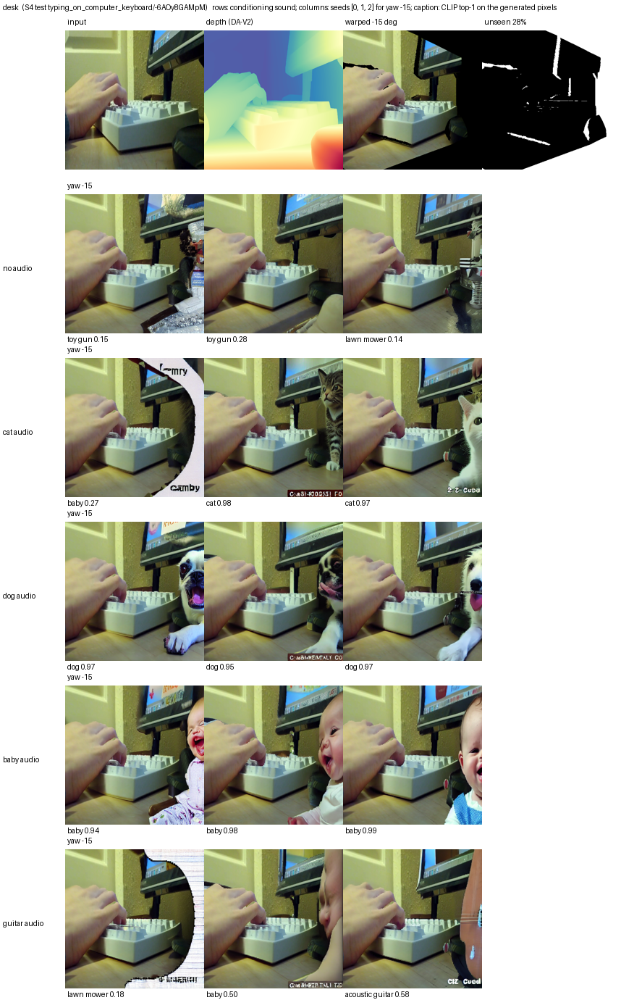
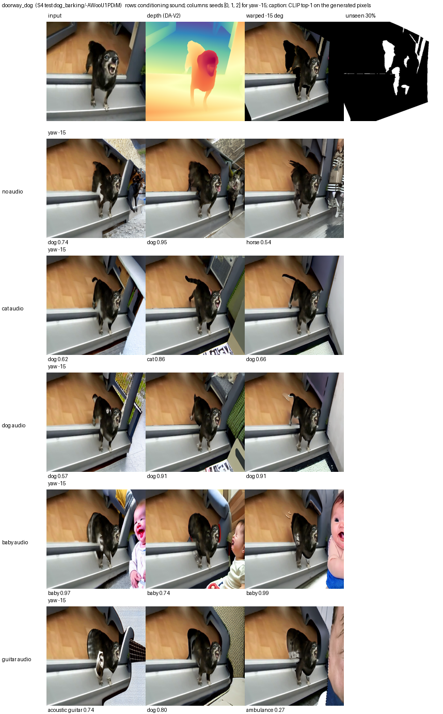
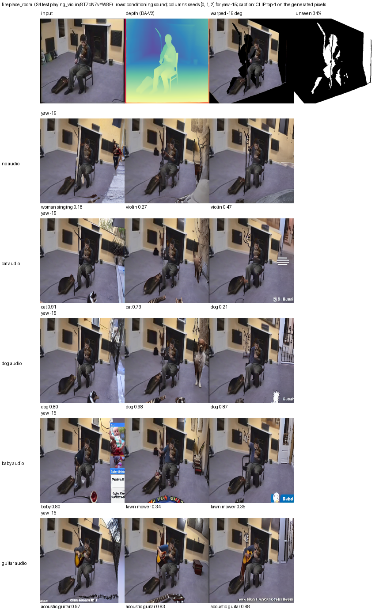
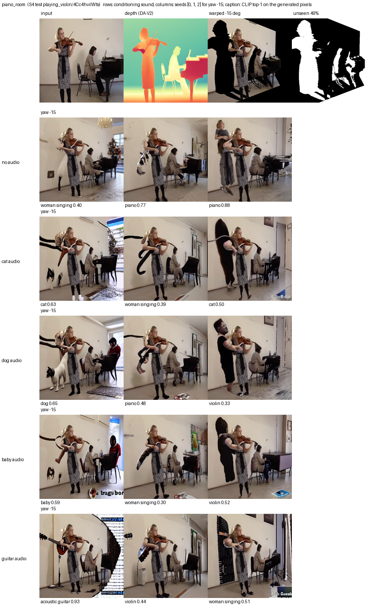
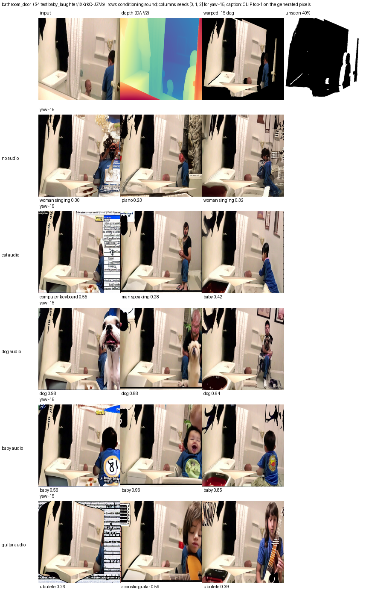
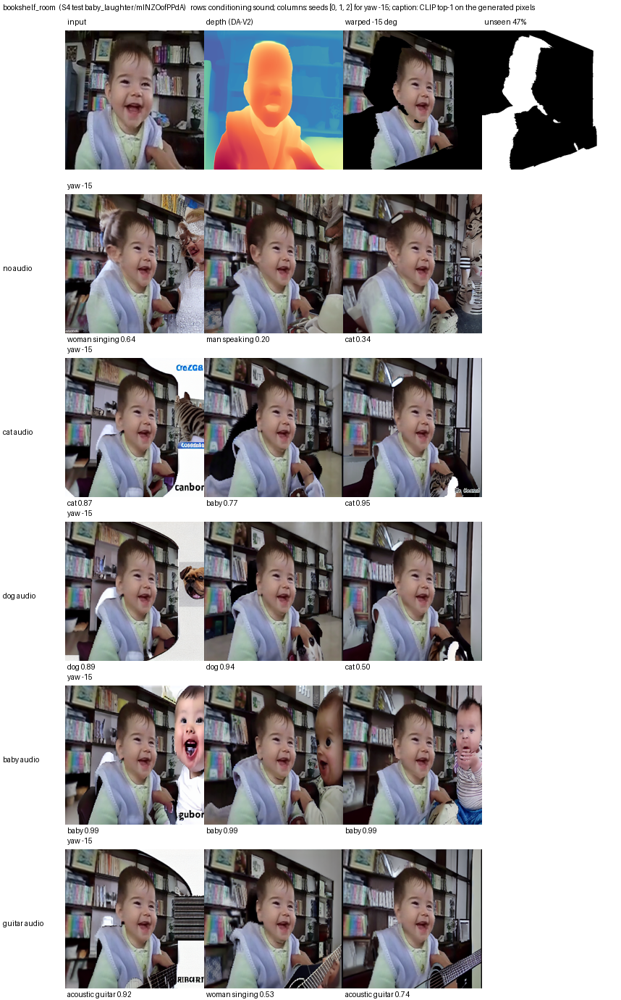
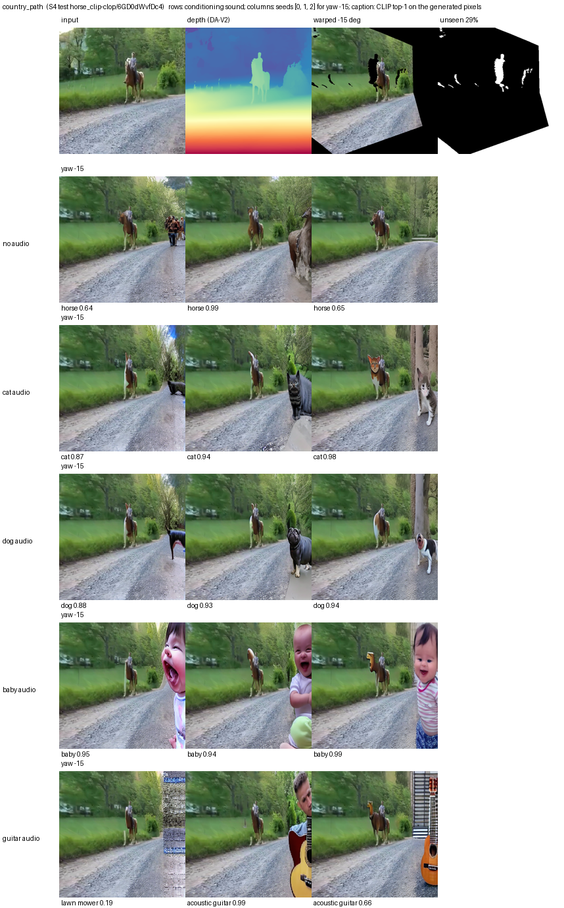
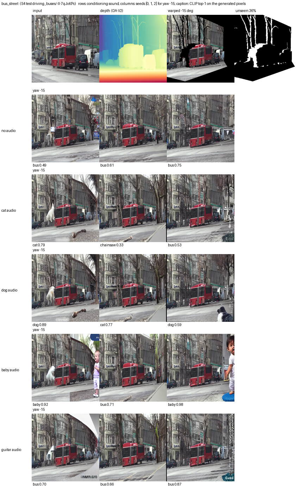
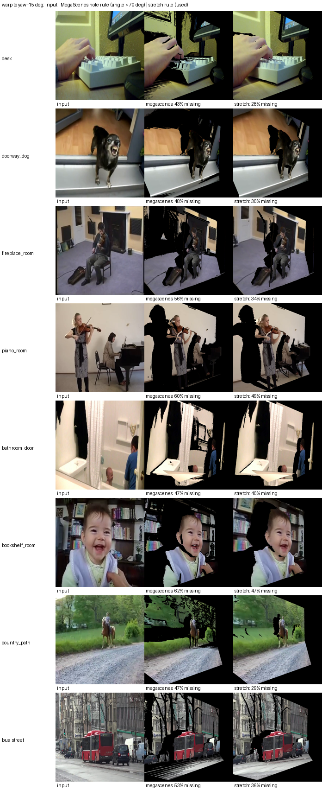

# Look-around evaluation (depth → MegaScenes warp → audio-conditioned inpainting)

Generated by `scripts/eval_novel_view.py report`.

- **Grid:** 8 scenes × 1 poses (yaw -15°, MegaScenes orbit, camera moves back for both directions (tz = |sin yaw|); focal 80 px at 256 px, ≈116° FoV) × 5 conditions (no audio + cat, dog, baby, guitar) × 3 seeds = **120 images**, 50 DDIM steps, guidance 7.5, mask dilation 8 px.
- Scenes and sounds are AVSBench S4 **test** clips (frames are 224 px, upscaled to 512).
- Audio and no-audio images use the same seeds and masks, so they differ only in the conditioning.
- **Score:** CLIP ViT-L/14 zero-shot over the 23 S4 classes (`a photo of {object}.`), shown **only the generated pixels** (mask bounding box, everything else gray). It measures whether the requested object appears in the revealed region; it does not judge realism.

## Does the sound decide what appears?

| sound | CLIP class | top-1 with audio | top-1 without audio | P(class) with / without | audio > no-audio (paired) |
|---|---|---|---|---|---|
| cat | a cat | **54%** | 4% | 0.50 / 0.04 | 88% |
| dog | a dog | **83%** | 8% | 0.74 / 0.12 | 92% |
| baby | a baby | **79%** | 0% | 0.72 / 0.03 | 100% |
| guitar | an acoustic guitar | **46%** | 0% | 0.41 / 0.01 | 92% |
| **all** | | **66%** | 3% | | 93% |

Each audio row has 24 images; "without audio" scores the same no-audio images against that row's class.

**Mean CLIP probability of each class (columns) per conditioning (rows):** the diagonal should dominate.

| conditioning | a cat | a dog | a baby | an acoustic guitar |
|---|---|---|---|---|
| no audio | 0.04 | 0.12 | 0.03 | 0.01 |
| cat | **0.50** | 0.12 | 0.07 | 0.00 |
| dog | 0.10 | **0.74** | 0.01 | 0.00 |
| baby | 0.02 | 0.02 | **0.72** | 0.00 |
| guitar | 0.01 | 0.04 | 0.03 | **0.41** |

**By pose** (top-1 hit rate, audio vs no audio):

| sound | yaw -15° |
|---|---|
| cat | 54% vs 4% |
| dog | 83% vs 8% |
| baby | 79% vs 0% |
| guitar | 46% vs 0% |

## Per scene

| scene | unseen pixels -15° | inpainted (dilated) | top-1 hit, audio | top-1 hit, no audio | sheet |
|---|---|---|---|---|---|
| desk | 28% | 40% | 75% | 0% | [png](sheets/desk.png) |
| doorway_dog | 30% | 42% | 67% | 17% | [png](sheets/doorway_dog.png) |
| fireplace_room | 34% | 47% | 75% | 0% | [png](sheets/fireplace_room.png) |
| piano_room | 49% | 65% | 42% | 0% | [png](sheets/piano_room.png) |
| bathroom_door | 40% | 51% | 58% | 0% | [png](sheets/bathroom_door.png) |
| bookshelf_room | 47% | 55% | 75% | 8% | [png](sheets/bookshelf_room.png) |
| country_path | 29% | 38% | 92% | 0% | [png](sheets/country_path.png) |
| bus_street | 36% | 55% | 42% | 0% | [png](sheets/bus_street.png) |

## Contact sheets

Header: input, depth, and for each pose the warped view (black = never seen) and the unseen-pixel mask. Rows: conditioning sound. Columns: seeds per pose. Caption: CLIP top-1 class and probability on the generated pixels.

### desk



### doorway_dog



### fireplace_room



### piano_room



### bathroom_door



### bookshelf_room



### country_path



### bus_street



## Hole rule: MegaScenes angle rule vs stretch rule



## Files

```
scenes/<scene>/input.png, depth.png, depth.npy, scene.json (pose, unseen/inpainted fractions)
scenes/<scene>/yaw±15/warped.png, mask.png (unseen), inpaint_mask.png (dilated),
                      megascenes_warped.png, megascenes_mask.png (MegaScenes hole rule, for comparison)
scenes/<scene>/yaw±15/<none|cat|dog|baby|guitar>/seed<k>.png   final images
sheets/<scene>.png, sheets/hole_rules.png
metrics.csv (one row per image), summary.json, generate_args.json
```
