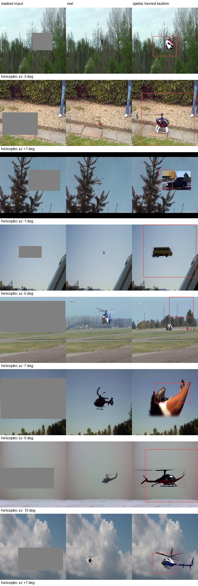

# Spatial audio: right object, right place (S4 test)

Generated by `scripts/eval_spatial.py report`.

- **Data:** 173 AVSBench S4 test clips whose sounding object is at most a third of the frame wide, frame 1, hole 3x the object's width and 1.6x its height with the object at one end of the hole (alternating left and right). The clip's own audio is rendered as FOA at the object's true direction (60 deg camera) and distance (from its pixel height and the class size prior), in the synthetic room of `models/spatial_audio.py` (critical distance 2 m, RT60 0.5 s).
- **Audio analysis:** direction error 3.9 deg mean (2.2 median); distance error 12% mean; CLAP zero-shot class from the beam 74.0%.
- **Found:** OWLv2 detects the clip's class inside the hole (score >= 0.1). **Centre hit:** the detected box's centre lies inside the real object's box, i.e. the right object in the right place (any size). **IoU hit:** IoU >= 0.3 with the real box (place and size). CLIP top-1 on the hole; LPIPS / PSNR against the real frame. Sources are rendered at 0.5-4 m (the indoor room model's range).

| conditioning | found | centre hit (right place) | IoU hit | centre error (frac. of width) | CLIP top-1 | LPIPS | PSNR |
|---|---|---|---|---|---|---|---|
| spatial, trained location | 90.2% | **43.4%** ± 7.4 | 40.5% | 0.150 | 89.0% | 0.601 | 10.86 |

Grid: the first 8 clips (not cherry-picked). Columns: masked input, real frame, then each conditioning; the red box is where the spatial methods were told the source is.

